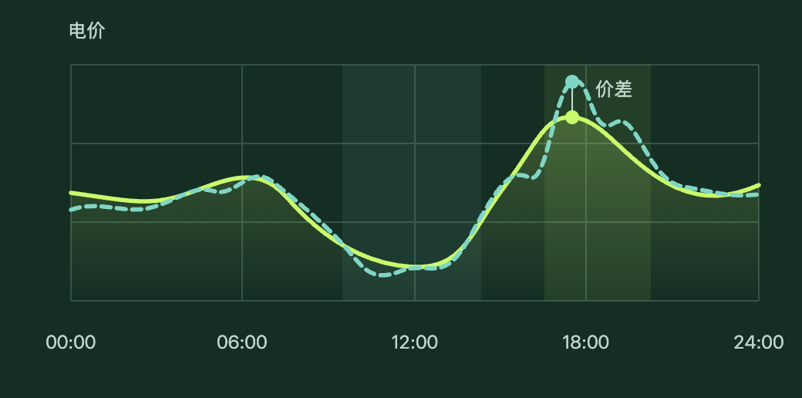

# 宁夏电力现货预测与独立储能报价

静态研究网站。内容包括宁夏市场规则、日前与实时电价预测、两类价差预测、储能报价生成、回测方案与来源。结算试算使用合成数据。

[打开专题网站](https://coolhz1.github.io/ningxia-power-market-research/)



实线代表日前价格，虚线代表实时价格。

网站发布目录为 main 分支的 /docs。无需安装依赖或执行构建。改动章节时先更新 report.txt，再运行：

```sh
python3 build.py
python3 -m http.server 4173 --directory docs
```

布局在 template.html，试算组件在 calculator.html，样式和脚本在 docs/assets。GitHub Pages 使用分支发布。
